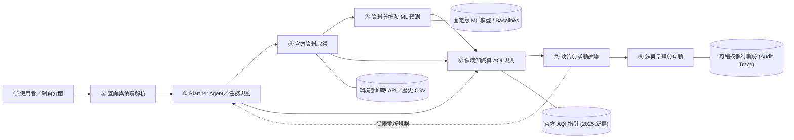

# AirGuard AI — 智慧空氣品質預測與生活決策代理人

> **課程名稱**：物聯網數據分析與應用（AIoT-DA）  
> **專案性質**：三人團體期末專題  
> **目前階段**：提案與系統設計階段（Proposal & System Design Phase）  
> **組員名單**：（組員資訊待補：姓名 / 學號）

---

## 專案簡介 (Overview)

**AirGuard AI** 是一個專為戶外運動愛好者與敏感族群設計的 **Domain AI Agent**。本專案不只做單純的模型預測，也不做無約束的通用對話聊天機器人，而是設計一個**「懂領域知識、能自動取得官方資料、會嚴謹分析與回測、具白名單工具推理，並能提供客觀證據與安全邊界」**的決策代理人系統。

本系統以**臺灣環境部（MOENV）**官方即時與歷史監測資料為核心基礎，結合 1、3、6 小時 PM2.5 短期時間序列機器學習預測，並導入 2025 年最新修訂門檻的 AQI 官方活動指引，提供具備資料時間戳、誤差帶與官方指引依據的可解釋決策卡片。

> [!IMPORTANT]
> **學術誠實原則聲明（Academic Honesty Declaration）**  
> 本專案目前處於 **Proposal 提案與系統架構設計階段**。所有列出之模型成效、回測數據與系統功能均為**「預期成果（Expected Outcomes）」**，尚未進行實際訓練與回測驗證。本團隊嚴格遵守學術誠實原則，絕不宣稱未經回測的準確率或健康保證。

---

## 核心安全防線與設計邊界 (Core Boundaries)

為防範大型語言模型（LLM）常見之幻覺（Hallucination）與醫療越權診斷風險，本專案確立四大設計防線：

1. **測站尺度 ≠ 街道個人暴露**：測站觀測值僅代表固定測站周邊巨觀空氣品質，絕不宣稱可替代任意街道或個人的精準暴露劑量。
2. **PM2.5 預測 ≠ 官方 AQI 預報**：機器學習預測之 1/3/6h PM2.5 數值僅供趨勢參考，嚴格區隔於官方發布之 AQI，不自行計算或冒充「官方空品預報」。
3. **時距外推限制**：嚴禁以 1/3/6 小時模型任意向外推論隔日全天或長期趨勢；超出時距時主動觸發安全降級。
4. **非醫療診斷**：所有建議均依據官方公開之活動指引，不提供任何個人醫療診斷、治療指示或健康結果保證。

---

## 系統八大模組架構 (System Architecture)

系統完全遵循正式提案與 [`myplan/DESIGN.md`](myplan/DESIGN.md) 規劃之八個編號模組（①–⑧）：



### 模組功能對照表

| 編號 | 模組名稱 | 功能職責 | 預定實作路徑 |
| :--- | :--- | :--- | :--- |
| **①** | **使用者／網頁介面** | 運動情境輸入、測站／族群選擇、視覺化圖表與建議卡片呈現 | `app/` (Next.js) |
| **②** | **查詢與情境解析** | 提取意圖、時間窗口、測站地點、活動強度與一般／敏感族群標記 | `src/airguard/query.py` |
| **③** | **Planner Agent** | 白名單工具（Allowlist Tools）調度、執行計畫生成、安全降級控制 | `src/airguard/agent.py` |
| **④** | **官方資料取得** | 環境部 API / CSV 自動取得、資料新鮮度查核與品質驗證（ETL） | `src/airguard/data/` |
| **⑤** | **資料分析與 ML 預測** | 防時序洩漏之 1/3/6h PM2.5 預測、基線比較（Persistence / Seasonal Naive） | `src/airguard/ml/` |
| **⑥** | **領域知識與 AQI 規則** | 2025 最新 AQI 分級門檻、六大污染物副指標、一般與敏感族群活動指引 | `src/airguard/domain/` |
| **⑦** | **決策與活動建議** | 候選運動時段比較、誤差帶交叉比對、保守安全原則約束 | `src/airguard/decision.py` |
| **⑧** | **結果呈現與互動** | 整合官方觀測卡、預測趨勢卡、活動指引卡與完整資料來源追溯（Provenance） | `src/airguard/report.py` |

---

## 官方資料來源 (Data Sources)

| 資料集代碼 | 資料集名稱 | 用途與說明 |
| :--- | :--- | :--- |
| **`AQX_P_432`** | 環境部每小時空氣品質指標 (AQI) | 取得正式公布之即時/近期測站 AQI 與主污染物數據 |
| **`AQX_P_488`** | 環境部歷史空氣品質指標 (AQI) | 歷史回測驗證輔助、季節趨勢查核 |
| **`AQX_P_13`** | 環境部空氣品質監測小時值 (PM2.5) | 1/3/6h 時間序列特徵工程與模型訓練主要輸入 |
| **`MOENV_AQI_GUIDE`** | 環境部 AQI 官方活動指引 | 採用 2025 年 1 月 1 日起實施之最新 AQI 分級與活動建議規範 |

---

## 雙軌評估規劃 (Evaluation Plan)

本專案規劃嚴謹的雙軌驗證機制（Track A 與 Track B）：

### Track A: 時間序列預測評估 (PM2.5 Forecast)
- **資料集**：以臺中市代表性測站（如忠明、西屯等）2024–2026 年觀測資料為基礎。
- **嚴防時間洩漏**：採嚴格時間先後順序切分（70% Train / 15% Val / 15% Test），配合 Rolling-origin 交叉驗證。
- **基線模型（Baselines）**：
  - *Persistence*：$\hat{y}(t+h) = y(t)$
  - *Seasonal Naive*：$\hat{y}(t+h) = y(t+h-24h)$
- **候選模型**：Ridge Regression、Random Forest、XGBoost（延伸比較 LSTM）。
- **評估指標**：MAE（平均絕對誤差）、RMSE、相對改善增益（$\text{Skill\_MAE} = 1 - \frac{\text{MAE}_{\text{model}}}{\text{MAE}_{\text{persistence}}}$）。

### Track B: Domain AI Agent 決策評估 (Agent & Decision)
- **情境測試集**：建立至少 30 個標準化測試情境（涵蓋一般／敏感族群、地理歧義、API 延遲、缺值異常、超時距外推請求等）。
- **驗收指標**：
  - 工具選擇正確率（Tool Selection Accuracy）
  - 官方指引一致率（Guidance Consistency）
  - 來源與時間標註完整率（Provenance Completeness）
  - 安全降級達成率（Graceful Degradation Rate）
  - 系統響應延遲（Response Latency）

---

## 六週實作交付路線圖 (Roadmap)

```text
W1 (資料盤點)  ──▶  W2 (模型基線)  ──▶  W3 (Agent 核心)  ──▶  W4 (Web 整合)  ──▶  W5 (雙軌實驗)  ──▶  W6 (期末交付)
 盤點 API/CSV       建立 Persistence     實作 Tool Allowlist    打造 UI 互動介面     執行分站/時距回測    彙整 Final PPT
 凍結測站與期間     訓練 Ridge/RF/XGB    結合官方 2025 指引     串接 API/Agent       30 個 Agent 測試集   展示影片與結案
```

---

## 專案結構 (Repository Structure)

```text
DIC3-ProjectRefactor/
├── .agents/                 # OpenSpec 與 Antigravity AI 輔助工作流程配置
│   ├── skills/              # openspec-propose, apply, archive 等自定義技能
│   └── workflows/           # 規格驅動開發指令與引導流程
├── myplan/                  # 期末專案提案規劃與科研 SOP 參考文件
│   ├── DESIGN.md            # AirGuard AI 完整系統架構與實作設計規格書
│   ├── A2Z outline example.pdf
│   ├── AirGuard_AI_Final_Proposal.docx
│   └── 空品決策代理人.md
├── openspec/                # OpenSpec 規格驅動開發資料庫
│   ├── config.yaml          # OpenSpec 設定檔 (語言: zh-TW)
│   ├── changes/             # 進行中與已歸檔之變更提案
│   └── specs/               # 系統能力規格庫 (Source of Truth)
├── .gitignore               # Git 忽略設定
└── README.md                # 專案首頁說明文件（本檔案）
```

---

## 開發規範與規格驅動開發 (Spec-Driven Development)

本專案全面導入 **[OpenSpec](https://github.com/Fission-AI/OpenSpec)** 規格驅動開發工作流程，確保所有功能在實作前皆有清晰的規格邊界、測試情境與資料契約：

* **提案發起**：`/opsx-propose <變更名稱>`
* **任務執行**：`/opsx-apply`
* **規格同步與歸檔**：`/opsx-archive`

---

## 參考文獻與資料連結

1. 中華民國環境部空氣品質監測網：<https://airtw.moenv.gov.tw/>
2. 環境部空氣品質指標（AQI）活動建議（2025 修訂版）：<https://airtw.moenv.gov.tw/cht/Information/Standard/AirQualityIndicatorNew.aspx>
3. 環境部開放資料平臺（AQX_P_432 / AQX_P_13）：<https://data.moenv.gov.tw/>
4. World Health Organization (WHO), *Ambient (outdoor) air pollution*, 2024.
5. Fission-AI / OpenSpec: Spec-Driven Development Framework: <https://github.com/Fission-AI/OpenSpec>

