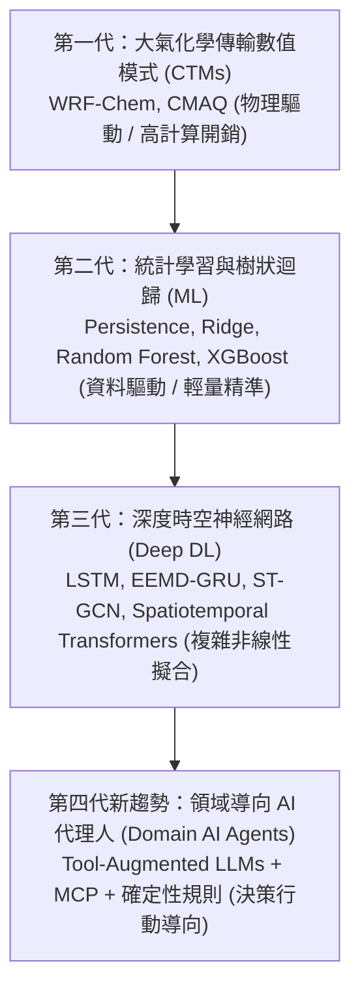

# AirGuard AI 提案報告重構：相關研究 (Related Work)

> **遵循架構**：依據《A2Z outline example》科研論文 SOP 之 **M–O 三段式架構**  
> **平衡原則**：嚴格落實 **AI 技術 50% + 領域知識與標準 50%** 之均衡論述  
> **重點產出**：標準 8 欄文獻摘要彙整表（Article Summary Table）與 Research Gap 轉折推導

---

## 2.1 M — Methods：空氣品質預測技術之發展脈絡與方法分類

空氣品質預測長期以來是大氣科學、公共衛生與計算機科學的交叉研究焦點。回顧近數十年之技術演進，主要方法依建模範式與運算複雜度可劃分為三大發展階段：



### 1. 物理化學傳輸模式 (Chemical Transport Models, CTMs)
以 WRF-Chem、CMAQ（Community Multiscale Air Quality Modeling System）與 CAMx 為代表。此類方法依據流體力學 Navier-Stokes 方程、大氣邊界層熱力學及大氣光化學反應機制進行偏微分方程求解。
* **優點**：具備嚴謹的物理可解釋性，能模擬跨國界長程傳輸（如東亞沙塵暴或境外污染團襲臺）。
* **局限**：對初始大氣邊界條件與排放清冊（Emission Inventories）之準確度極端敏感，且需要超級電腦叢集執行龐大數值模擬，預報更新週期通常在數小時乃至半日以上，無法針對測站突發之超局部短期變化提供隨選（On-Demand）推論。

### 2. 統計學習與經典機器學習 (Statistical & Classical ML)
隨著自動監測站網（Continuous Air Quality Monitoring Stations, CAQMS）累積龐大逐時觀測資料，資料驅動的統計迴歸成為主流。
* **基線方法（Baselines）**：包含持續性基線（Persistence, 即 $\hat{y}_{t+h} = y_t$）與季節性樸素模型（Seasonal Naive）。在大氣具備顯著時間自相關性的 1 小時超短期預報中，Persistence 展現出極強的抗雜訊能力，是國際評測中不可略過的最低基準。
* **正規化與樹集成模型**：Ridge/Lasso 迴歸透過 L1/L2 正則化提供線性關係基準；而隨機森林（Random Forest）與極端梯度提升樹（XGBoost, LightGBM）則擅長捕捉氣溫、風速、相對濕度等氣象特徵與污染物間的高度非線性交互作用。近年研究（如 Joseph & Ganapathy, 2025）指出，在特徵工程完備的測站級短期預測任務中，XGBoost 的表現往往匹敵甚至超越未經精細微調的深度學習模型，且運算開銷微小、推論時間在毫秒級，具備極高實用價值。

### 3. 深度學習與時空圖神經網路 (Deep Spatiotemporal Models)
為克服傳統模型對長時序相依性捕捉之局限，深度神經網路廣泛應用於空品時序預測：
* **循環模型與分解技術**：LSTM 與 GRU 被廣泛用於時間相依性建模。在地研究（如 Lo et al., 2025 於臺灣臺中西屯站）利用集合經驗模態分解（EEMD）結合 GRU，取得優異之等級分類正確率。
* **時空圖卷積（ST-GCN）**：將多個測站抽象為圖節點（Nodes），將測站間空間距離或大氣擴散連通性定義為圖邊（Edges）。近期針對雲林 10 個測站的 ST-GCN 實證（2025/2026）顯示，其 1 小時預測 MAE 可達 2.71 μg/m³ 左右。然而，深度模型參數龐大，訓練耗時，容易在歷史數據中發生過擬合，且黑盒特性難以向大眾解釋預測之置信度。

---

## 2.2 N — New Proposed：領域 AI 代理人與工具擴增前沿趨勢

隨著大型語言模型（LLMs）由純文本對話邁向「自主代理人（Autonomous Agents）」，環境領域之應用迎來典範轉移：

### 1. 工具導向與模型上下文協定 (Tool-Augmented LLMs & MCP)
傳統對話模型無法獲取即時環境狀態。藉由 ReAct（Reasoning + Acting）與 Anthropic 推動之模型上下文協定（Model Context Protocol, MCP），LLM 能夠動態調用外部 API 與計算工具。2025 年 Pan & Nipu 針對即時空品介面之研究證實，透過結構化工具調度，代理人在事實正確性與幻覺控制上均獲專家高度評估（4.84/5）。

### 2. 確定性規則約束與護欄安全 (Deterministic Guardrails)
然而，將環境決策完全交付 LLM 存在重大系統性風險：
* **工具介面是核心失敗點**：2026 年自然出版集團《npj Clean Air》發表的 Neuro-Air 多代理系統研究指出，在常規函式呼叫基準測試中，45.3% 的執行會出現至少一次錯誤，且其中高達 95.6% 集中於工具參數介面與 Schema 解析錯誤（Ma et al., 2026）。
* **事後矛盾與醫療越權**：2026 年最新評測集《ToolHACE》指出，即使工具返回正確資料，LLM 仍可能生成與工具輸出自相矛盾的結論；而在醫療健康提問上，通用 LLM 給出不安全回答的比例亦達 5%–13%（Draelos et al., 2026）。

因此，最新學術趨勢強調「**白名單受限呼叫（Allowlist Tool Calling）**」與「**確定性程式碼守門（Deterministic Code Verification）**」：嚴禁 LLM 介入數值計算與法規門檻判定，LLM 僅能充當自然語言與標準工具之間的語意適配器。

---

## 2.3 O — Organize：八欄核心文獻對照表與 Research Gap 轉折

### Article Summary Table（核心代表作 8 欄對照表）

| Ref / Author | Year | Problem (研究問題) | AI Method (AI/ML 方法) | Domain Knowledge (領域知識/法規) | Dataset (資料集來源) | Findings (核心發現) | Limitation (現存局限) |
| :--- | :--- | :--- | :--- | :--- | :--- | :--- | :--- |
| **Chianese & Riccio** | 2026 | 空氣品質預測模型綜述與評估基準 | ML (RF, XGB) vs DL (LSTM, Transformer) | 大氣邊界層物理、污染物傳輸機制 | 歐洲大氣環境署 (EEA) 多國監測站 | 樹集成模型在短期預測中展現最高穩定性與計算效益 | 缺乏與終端生活決策與行動指引之串接 |
| **Pan & Nipu** | 2025 | 缺乏直覺之即時空品對話查詢介面 | MCP 工具導向 LLM 代理人 | 即時感測器指標、開放資料 API | 美國 EPA AirNow API 即時流 | 專家評分事實正確性 4.78、幻覺控制 4.84 | 僅做即時單點查詢，無未來趨勢預測與官方活動指引 |
| **Ma et al. (Neuro-Air)** | 2026 | 多代理人協同分析複雜大氣污染現象 | Multi-Agent LLM (SQL/Python 工具調用) | 大氣化學擴散方程、排放源解析 | 中國國家環境監測總隊逐時資料 | 多代理協同可完成專家級大氣歸因報告 | 45.3% 執行有工具介面錯誤；面向治理者而非大眾 |
| **Draelos et al.** | 2026 | 通用 LLM 應用於健康與臨床諮詢之安全性 | 醫師紅隊測試 (GPT-4, Claude, Llama) | 臨床醫學指引、病患安全性檢核 | 222 題臨床高風險情境問答 | 通用 LLM 具 5%–13% 之危險不安全回答率 | 證明通用對話模型不可直接用於個人健康決策 |
| **Lo et al.** | 2025 | 臺灣都會測站高精度短期 AQI 預測 | EEMD 模態分解 + GRU 循環網路 | 臺灣環境部 AQI 分級門檻、風向風速特徵 | 臺灣環境部臺中西屯站逐時觀測 | 217 測試日中等級預測正確率達 95.39% | 純數值輸出；未納入 2025 新制門檻；無決策代理人 |
| **BMC Medicine** | 2025 | 戶外運動強度與空污暴露之死亡率交互作用 | 劑量反應統合分析 (Meta-Analysis) | 運動生理學、心血管疾病、PM2.5 閾值 | 150 萬名成年人長期世代追蹤研究 | PM2.5 > 25 μg/m³ 時運動健康保護效益腰斬 (30%→12%) | 純流行病學實證，缺乏日常動態時段調整之工具 |
| **WHO Guidelines** | 2024 | 全球室外空氣污染疾病負擔與干預指引 | 流行病學危險比 (Hazard Ratios) | PM2.5 年均 5 μg/m³、日均 15 μg/m³ 建議 | 全球 117 國空品與疾病負擔資料庫 | 空污每年致 810 萬死；鼓勵維持運動但需調整時地 | 國際指引為巨觀門檻，無法直接對應在地即時動態 |
| **臺灣環境部 (MOENV)** | 2025/2026 | 2025 新版 AQI 標準修訂與活動防護指引 | 法定分級計算副指標、統計回溯 | PM2.5/O₃ 新制門檻、一般/敏感族群指引 | 臺灣 76 個自動監測站網實測數據 | 加嚴良好門檻 (0–12.4 μg/m³)，良好天數比例下修 | 僅為靜態法規網頁與 7 大區日預報，無逐時排程建議 |

---

### Research Gap 歸納與本專案技術定位轉折

從上述頂級文獻與官方標準的系統梳理中，可以精確推導出當前學界尚未攻克的核心缺口：

```text
【文獻現況】
1. ML/DL 預測模型 (Chianese 2026; Lo 2025) ──▶ 能算出精準數字，但只有孤立數值，無法回答「幾點適合跑」。
2. LLM 工具代理人 (Pan 2025; Ma 2026)      ──▶ 能對話查即時值，但缺乏短期時序預測，且工具失敗率高達 45.3%。
3. 醫學與公衛指引 (BMC 2025; WHO 2024)      ──▶ 證實 25 μg/m³ 效益折損並建議調整時地，但大眾無工具可依循。
4. 通用生成式 AI (Draelos 2026)             ──▶ 存在 5%–13% 醫療越權與假前提延伸，直接詢問具有危害性。
                                     ▼
                      【本專案之 Research Gap 轉折】
 亟需一套將「時間序列數值回歸」＋「官方 2025 法定規則」＋「白名單約束 Agent」
               三者完整解耦、各自獨立驗證的安全決策系統！
                                     ▼
                       【AirGuard AI 的創新定位】
 預測交給統計模型（Track A 驗收）｜ 規則交給官方指引 ｜ 轉譯交給語言代理人（Track B 驗收）
```
